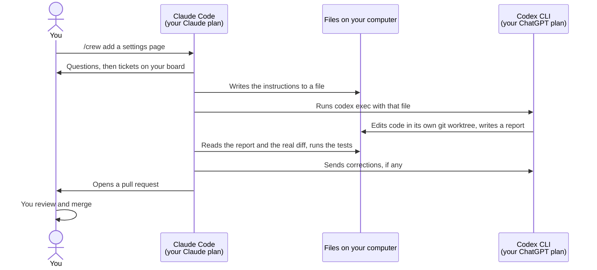

# crew

> [!IMPORTANT]
> **You need two paid subscriptions to use crew:**
>
> 1. **A Claude subscription** (Pro, Max, Ultra, Team, or Enterprise) for Claude Code.
> 2. **A ChatGPT subscription** (Plus or higher) for the Codex CLI.
>
> Crew runs on **your own** accounts. You sign in to each tool yourself, on your own computer. Nothing in this repo contains or uses anyone else's login, token, or key, and crew never asks for, stores, or sends yours. See [What you need](#what-you-need) for details.

A [Claude Code](https://code.claude.com/docs) skill that makes two AI coding agents work as a team on your own computer, using the subscriptions you already pay for.

- **Claude is the boss.** It plans with you, writes tickets, reviews the work, and opens pull requests. It never edits your application code.
- **Codex is the employee.** It writes all the code and tests, and it can push back when the plan is wrong.
- **You are the owner.** You answer questions and merge the pull requests. Nothing merges without you.

No code is accepted without review by the model that did not write it.

You do not need an API key for either agent. You sign in to each tool with your normal Claude and ChatGPT accounts, and crew runs those tools for you.

## Contents

1. [How the two accounts connect](#how-the-two-accounts-connect)
2. [What you need](#what-you-need)
3. [Step 1: Install the tools](#step-1-install-the-tools)
4. [Step 2: Connect your subscriptions](#step-2-connect-your-subscriptions)
5. [Step 3: Install crew](#step-3-install-crew)
6. [Step 4: First run](#step-4-first-run)
7. [Using crew](#using-crew)
8. [Security](#security)
9. [Settings](#settings)
10. [Troubleshooting](#troubleshooting)
11. [Update or remove](#update-or-remove)
12. [Working on crew itself](#working-on-crew-itself)

## How the two accounts connect

They do not connect to each other. There is no link between your Claude account and your ChatGPT account, and neither company ever sees the other's login.

Both are ordinary programs on your computer, each signed in on its own. Claude runs Codex the same way you would type a command in a terminal, and they pass work through files on disk.



So "connecting" means signing in to each tool once. Crew never asks for, stores, or passes along a password, token, or key.

| | Paid by | Sign in with | What crew runs |
|---|---|---|---|
| **Boss** | Your Claude plan | `claude auth login` | Claude Code, where you type `/crew` |
| **Employee** | Your ChatGPT plan | `codex login` | `codex exec`, started by Claude |
| **Tickets and PRs** | Free | `gh auth login` | The GitHub CLI |

## What you need

| Thing | Details |
|---|---|
| **Claude plan** | Pro, Max, Ultra, Team, or Enterprise. [The free plan does not include Claude Code.](https://code.claude.com/docs/en/setup#authenticate) |
| **ChatGPT plan** | Plus or higher is the safe choice. [OpenAI lists Codex in every plan](https://learn.chatgpt.com/docs/pricing), but for Free and Go the page mentions only the desktop app, so the command line tool crew needs may not be included. On Enterprise and Edu, an admin may need to turn on the default model. |
| **GitHub account** | Free is fine. Crew uses Issues, Projects, and pull requests. |
| **Computer** | macOS or Linux. Tested on macOS; the guard hook tests also pass on Ubuntu. Windows through WSL may work but is untested. |
| **Claude Code** | 2.1.295 or newer |
| **Codex CLI** | Written and tested against 0.164.0 |
| **gh, git, jq** | gh 2.94 or newer. jq is optional for the guard, which can fall back to python3, but crew's checks expect it. |

Heavy use can reach your plan limits on either side. A long ticket uses a lot, and the two plans run out separately. [What happens when you hit a limit](#troubleshooting).

## Step 1: Install the tools

You can skip anything you already have. Check with `claude --version`, `codex --version`, `gh --version`.

```bash
# Claude Code (see https://code.claude.com/docs/en/setup for other ways)
curl -fsSL https://claude.ai/install.sh | bash

# Codex CLI (see https://learn.chatgpt.com/docs/cli for other ways)
curl -fsSL https://chatgpt.com/codex/install.sh | sh

# GitHub CLI and jq on macOS (Linux: https://github.com/cli/cli#installation)
brew install gh jq
```

These commands download and run an installer. If you would rather read one first, download it to a file and open it.

Then install the Matt Pocock skills for **both** agents. Crew uses them for planning, testing, and review.

```bash
claude plugin marketplace add mattpocock/skills
claude plugin install mattpocock-skills@mattpocock

codex plugin marketplace add mattpocock/skills
codex plugin add mattpocock-skills@mattpocock
```

## Step 2: Connect your subscriptions

Do this in a normal terminal. Every sign in happens in your browser, on the company's own page. You never paste a password or key into a file, into crew, or into a chat.

### Connect your Claude subscription

```bash
claude auth login
```

Your browser opens. Sign in with the Claude account that has your subscription. If it shows a code instead of returning to the terminal, paste the code into the terminal.

Check it:

```bash
claude auth status
```

You want to see these two lines, with your own plan name:

```text
"authMethod": "claude.ai",
"subscriptionType": "pro",
```

If `authMethod` says anything else, Claude Code may be billing somewhere other than your subscription. See [Make sure the right account pays](#make-sure-the-right-account-pays).

### Connect your ChatGPT subscription

```bash
codex login
```

Your browser opens. Choose **Sign in with ChatGPT** and use the account that has your plan.

On a computer with no browser, such as a server you reach over SSH, first turn on device code login in your ChatGPT security settings, then run:

```bash
codex login --device-auth
```

Check it:

```bash
codex login status
```

You want to see:

```text
Logged in using ChatGPT
```

### Connect GitHub

```bash
gh auth login
gh auth refresh -s project
```

The second command adds the `project` permission, which crew needs to move tickets on your board. It is not included by default. Check with `gh auth status`; the token scopes should include `repo` and `project`.

### Make sure the right account pays

This step is easy to skip, and it matters most. **An API key in your environment can quietly move your usage from your flat plan to pay per use billing.** Run this to list which ones are set. It prints names only, never values:

```bash
for v in CODEX_API_KEY OPENAI_API_KEY ANTHROPIC_API_KEY ANTHROPIC_AUTH_TOKEN; do
  printenv "$v" >/dev/null && echo "$v is set"
done
```

No output is what you want. If a name appears:

| Variable | What it does | What to do |
|---|---|---|
| `CODEX_API_KEY` | **Replaces your ChatGPT login for `codex exec`, which is what crew uses.** `codex login status` still says "Logged in using ChatGPT", so that check will not warn you. Crew's readiness check stops if this is set. | `unset CODEX_API_KEY`, and remove it from `~/.zshrc`, `~/.bashrc`, or wherever you set it. |
| `ANTHROPIC_API_KEY` | Claude Code [prefers it over your subscription](https://code.claude.com/docs/en/authentication#authentication-precedence) once you approve it, and always uses it in `claude -p` mode. | `unset ANTHROPIC_API_KEY`, then confirm with `/status` inside Claude Code. |
| `ANTHROPIC_AUTH_TOKEN` | Claude Code also prefers it over your subscription. | Same as above, unless your company set it on purpose. |
| `OPENAI_API_KEY` | Did not replace the ChatGPT login when we tested Codex 0.164.0 with a fake key. Other Codex versions may differ. | Safe to leave, but a used key is easy to check on your [OpenAI usage page](https://platform.openai.com/usage). |

The `CODEX_API_KEY` and `OPENAI_API_KEY` results come from testing with a fake key, not from OpenAI's documentation, which does not describe this. If you want to be certain on your version, run the test yourself: `CODEX_API_KEY=fake codex exec --sandbox read-only --skip-git-repo-check "Reply OK"`. A 401 error means that variable takes over from your login.

### Test both connections

Each of these makes one small request against your plan:

```bash
claude -p "Reply with the single word OK."
printf 'Reply with the single word OK.' | codex exec --sandbox read-only --skip-git-repo-check -
```

Both should reply `OK`. If they do, your subscriptions are connected.

### Where your logins live

Each tool stores its own login in its own place, outside any project. Crew does not read or copy these.

| Tool | Stored in |
|---|---|
| Claude Code | [macOS Keychain on a Mac](https://code.claude.com/docs/en/authentication#credential-management); `~/.claude/.credentials.json` on Linux |
| Codex | [`~/.codex/auth.json`, or your system's credential store](https://learn.chatgpt.com/docs/auth) if you choose that |
| GitHub CLI | Your system keyring, or `~/.config/gh/hosts.yml` |

OpenAI's advice is to treat `~/.codex/auth.json` like a password. You can keep the Codex login out of a plain file by adding this to `~/.codex/config.toml` and signing in again:

```toml
cli_auth_credentials_store = "keyring"
```

### What your plan does and does not cover

- **One person, their own computer.** This setup is meant for you, signed in as you, on a machine you control.
- **Do not put these logins on a server or in CI.** OpenAI [recommends API keys for automated jobs such as CI/CD](https://learn.chatgpt.com/docs/auth) and warns against exposing Codex in untrusted or public environments. Never copy `auth.json` to a CI runner or a shared machine, and do not share an account.
- **An app you build is a separate matter.** If your own product calls an AI model for its users, that needs its own API key and billing. Your subscription login is for you using these tools, not a service your software can call.
- **Read the terms that apply to you.** Crew only runs the official tools, but your account and how you use it are your responsibility. Check the current [OpenAI](https://openai.com/policies/) and [Anthropic](https://www.anthropic.com/legal) terms if you are unsure, especially on a work account.

## Step 3: Install crew

```bash
git clone https://github.com/aminrezaabbasi/crew-skill.git
cd crew-skill
./install.sh
```

To see what it would do first, run `./install.sh --dry-run`.

The installer:

- Copies the skill to `~/.claude/skills/crew/`. If you set `CLAUDE_CONFIG_DIR`, it uses that folder instead.
- Creates `~/.crew/runs/`, private to your user, for run records.
- Saves `~/.crew/config.md` with your Codex model.
- Backs up any earlier version, and tests the new guard hook before it replaces the old one.
- Warns you if `~/.crew` is in a cloud synced folder.

It does not read or change your logins, shell profile, Claude Code settings, or Codex config. Anything you stored earlier, such as repo notes and run records, is kept.

If your plan does not include the default Codex model, choose another:

```bash
./install.sh --codex-model <model name>
```

## Step 4: First run

Open Claude Code **inside a project that has a GitHub repo**, then run:

```text
/reload-plugins
/crew doctor
```

`/crew doctor` checks everything and changes nothing except its own status file (`~/.crew/readiness.md`). It makes one small Codex request to confirm your plan includes the model. Local checks run through one reviewed script, `scripts/readiness.sh`, which prints the names of API key variables but never their values, and never opens a login file. Each line comes back as OK, WARN, or FAIL, with the fix:

- All the tools and their versions
- All three logins, and which account pays
- The skills on both agents, at matching versions
- That the guard hook is really active in your session
- Codex's safety settings

`/crew doctor --fix` also makes the safe fixes it can, after asking you once.

### Set up your board

Crew tracks tickets on a [GitHub Project](https://docs.github.com/en/issues/planning-and-tracking-with-projects). On your first task it offers to create one, then asks you to do one thing by hand, because changing a project's columns through the API can reset existing items:

1. Open the project, then **Settings**, **Fields**, **Status**.
2. Rename **Todo** to **Open**.
3. Add **Ready for Review** between **In Progress** and **Done**.

Optional: in the project's **Workflows** page, set **Item closed** to move items to **Done**.

## Using crew

| Command | What it does |
|---|---|
| `/crew <what you want>` | Plans the task. Small tasks get built right away. Bigger ones stop once the tickets are on your board. |
| `/crew next` | Builds the next ticket that is ready to go. |
| `/crew issue 42` | Builds that ticket. |
| `/crew review PR 12` | Makes the changes you asked for in your review comments. |
| `/crew doctor` | Checks your setup. |

### What a run looks like

1. **Check.** Crew confirms your tools and logins, so a task does not fail halfway.
2. **Plan.** It sizes the task and asks you about real decisions, each with a recommended answer. It writes a spec and tickets, and Codex gets to raise objections.
3. **Build.** One ticket per run, in its own [git worktree](https://git-scm.com/docs/git-worktree), so your working files are never touched. Codex writes the code and tests.
4. **Review.** Claude reads the real diff, runs the tests itself, and checks every acceptance criterion. Codex makes all the fixes, with at most two correction rounds.
5. **Deliver.** It scans for secrets, commits, then asks you before pushing and opening the pull request.
6. **You merge.** Crew never does. The next run spots the merge and moves the ticket to Done.

### What it asks you first

Crew always asks before: `git push`, opening a PR, commenting on a PR, creating a project, any `gh api` call, installing dependencies, and first time setup of a repo.

Claude Code may also show its own permission prompts. The skill only preapproves its routine commands for the turn that runs `/crew`, and [that grant ends at your next message](https://code.claude.com/docs/en/skills). If later prompts get in the way, you can allow the routine, read only commands in `~/.claude/settings.json`:

```json
{
  "permissions": {
    "allow": [
      "Bash(git status:*)",
      "Bash(git diff:*)",
      "Bash(git log:*)",
      "Bash(git fetch:*)",
      "Bash(gh issue view:*)",
      "Bash(gh pr view:*)",
      "Bash(gh project item-list:*)"
    ],
    "deny": [
      "Bash(gh pr merge:*)",
      "Bash(git push --force:*)"
    ]
  }
}
```

The guard hook only starts once you run `/crew` in a session, so these `deny` rules are a useful second layer for the rest of the time.

## Security

### What is and is not in this repo

This repo holds only the skill's instructions, three small scripts, an installer, and tests. It contains **no tokens, keys, logins, repo profiles, run records, or personal data**, and nothing in it needs any.

Your private data stays on your computer, outside this repo:

| Data | Where | Sent anywhere? |
|---|---|---|
| Your logins | See [where your logins live](#where-your-logins-live) | Only to the company that issued them |
| Repo profiles, board notes | `~/.claude/skills/crew/repos/` and `boards/` | No |
| Run records: prompts, logs, reports | `~/.crew/runs/` (private to your user) | No, but see below |
| Settings and status | `~/.crew/config.md`, `~/.crew/readiness.md` | No |

Install with `./install.sh` rather than symlinking the skill folder into a checkout. Crew writes notes next to `SKILL.md`, and a symlink could put them in a git repo. The installer refuses to install through a symlink.

### What the AI companies see

Crew does not add any new recipients, but be clear on what the tools send:

- **Anthropic** receives what Claude Code reads and sends: your prompts, the code it opens, and command output.
- **OpenAI** receives what Codex reads and sends: crew's instructions and the files it opens.

Your account's data settings with each company apply. Do not run crew on code you are not allowed to send to both.

### How crew protects you

**A guard hook.** `hooks/crew-guard.sh` checks every Bash command Claude runs after `/crew` starts, and blocks crew's never run list:

- **Merging and pushing to main:** `gh pr merge`, and direct pushes to `main` or `master`. The first push of a brand new repo is allowed.
- **Losing work:** force push, `git reset --hard`, `git clean`, `git commit --amend`, `git branch -D`, and discarding or stashing changes outside a crew worktree.
- **Deleting things on GitHub:** issues, projects, labels, repos, and `gh api` delete calls.
- **Deploying:** Vercel, Netlify, Fly, Firebase, Wrangler, Railway, EAS, Terraform, kubectl, Helm, `docker push`, `npm publish`, and remote Supabase changes.
- **Weakening Codex:** anything that loosens its sandbox or approvals, and any config override except the model and effort.
- **Reaching your logins:** `gh auth token`, and reading `~/.codex/auth.json`, `~/.claude/.credentials.json`, or `~/.config/gh/hosts.yml`.

If the hook itself crashes or times out, the command is blocked instead of allowed.

**A secret scan.** Before every commit, crew runs `scripts/secret-scan.sh` on the staged changes. It looks for common token shapes, private key blocks, `.env` files, local folder paths, and similar. It prints only the file, line, and rule, never the secret, so the scan cannot leak what it finds.

**Codex's sandbox.** Crew always runs Codex in its `workspace-write` or `read-only` sandbox. We tested what that means on macOS with Codex 0.164.0:

| Codex tries to | Result |
|---|---|
| Write in its own worktree | Allowed |
| Write elsewhere under your home folder | **Blocked** |
| Write in temporary folders such as `/tmp` | **Allowed** |
| Reach the network | **Blocked** |
| **Read files outside its worktree** | **Allowed** |

### Limits you should know

Security tools are only useful if you know where they stop.

- **Codex can read your files.** Its sandbox stops writing and network access, not reading, so it can open anything your user can, which may include your SSH keys, `.env` files in other projects, and `~/.codex/auth.json`. Whatever it reads can reach OpenAI as part of the conversation. A malicious file in a repo could try to talk it into this. So only run crew on code you trust, and keep real secrets out of plain files where you can.
- **The guard is not a sandbox.** It reads the words of each Bash command. It catches honest mistakes and commands written directly, but it cannot see inside a script file or another language (`python -c`, `node -e`), or a flag held in a variable. It also does not limit what Codex runs itself.
- **The guard only runs after `/crew`,** for the rest of that session. Some managed company settings turn off hooks in personal skills; `/crew doctor` tests for this.
- **The secret scan matches patterns.** A clean result means nothing looked like a known secret, not that there is none. Still read your diffs.
- **`gh` has real power.** Your GitHub login can do anything your account can. Consider a separate account or a limited token if the stakes are high.
- **Run records stay readable to your user.** They can hold code and logs, so keep `~/.crew` out of synced folders and backups you share.

### If a secret ever leaks

1. **Revoke it first** at its provider and make a new one. Assume anything pushed is already copied, even if you delete it a minute later.
2. Then remove it from the repo. Deleting it in a new commit does not remove it from history.
3. To sign out of a tool and end its login: `codex logout`, `/logout` inside Claude Code, `gh auth logout`.

### Publishing your own copy

If you fork this or publish changes:

```bash
git config core.hooksPath .githooks        # scans every commit before it happens
skill/scripts/secret-scan.sh --all         # scans your files
skill/scripts/secret-scan.sh --history     # scans every commit you have made
```

Never add `repos/`, `boards/`, or anything from `~/.crew/`. `.gitignore` covers the usual ones, but it does not protect a file you force add. Your commit email is also public; GitHub's [noreply address](https://docs.github.com/en/account-and-profile/setting-up-and-managing-your-personal-account-on-github/managing-email-preferences/setting-your-commit-email-address) keeps your real one private.

## Settings

`~/.crew/config.md` survives updates:

```text
codex_model: gpt-6.1-sol
```

| Setting | Meaning |
|---|---|
| `codex_model` | The Codex model to use. A repo profile can override it with its own `codex_model`. |
| `allow_api_billing: yes` | Lets crew run even though `CODEX_API_KEY` is set. Only add this if you really want Codex billed through the API. |

Crew picks the reasoning effort from the task size: medium for small and standard tasks, high for large ones. It never uses low. If your Claude session is set too low for the task, it asks you to raise it with `/effort high` first.

## Troubleshooting

| What you see | What it means | What to do |
|---|---|---|
| `/crew` is not found | Claude Code has not loaded the skill. | Run `/reload-plugins`, or restart Claude Code. |
| `401 Unauthorized` from Codex | Usually `CODEX_API_KEY` holds a bad key, or your login expired. | Run the [check above](#make-sure-the-right-account-pays), then `codex login`. |
| Codex says the model is not available | Your plan does not include it. | Set `codex_model` in `~/.crew/config.md` to [one your plan has](https://learn.chatgpt.com/docs/pricing). |
| "You've hit your usage limit" from Codex | Your ChatGPT plan's allowance ran out. The work so far is safe in the worktree. | Wait for the reset time in the message, or add credits at [your usage page](https://chatgpt.com/codex/settings/usage). Crew asks you which, then continues the same session. |
| "You've hit your session limit" from Claude | Your Claude plan's allowance ran out. | After the reset, run the same `/crew` command. It resumes from where it stopped. Check usage with `/usage`. |
| "Model at capacity" | A brief problem on OpenAI's side. | Crew retries the same session on the same model. |
| GitHub API rate limit | Too many requests in the hour. Nothing is lost. | Wait for the reset. Check with `gh api rate_limit --jq .resources`. |
| `crew-guard blocked: ...` | The command is on the never run list. | This is working as intended. If you truly want it, run it yourself. |
| Doctor says the guard is not on | The hook did not register in this session. | Run `/hooks`. Check that Claude Code is 2.1.295 or newer, and ask your admin about managed settings if it is a work computer. |
| Doctor says the plugin versions differ | The two agents have different versions of the skills. | Run `/crew doctor --fix`. |
| `gh` says a scope is missing | The login lacks the `project` permission. | `gh auth refresh -s project` |
| A local database or server acts strangely after cleanup | It may have been started from a worktree you removed. | Restart it from your main checkout. |

## Update or remove

**Update:** in your clone, run `git pull`, then `./install.sh`. Your settings, notes, and run records are kept, and the previous version is saved next to the new one as `SKILL.md.bak-<date>`.

**Remove:**

```bash
rm -rf ~/.claude/skills/crew     # the skill and its repo notes
rm -rf ~/.crew                   # run records and settings
```

Check those two folders first if you want to keep any notes. This does not sign you out of anything. To do that, see [If a secret ever leaks](#if-a-secret-ever-leaks), step 3.

## Working on crew itself

```text
skill/SKILL.md                 the instructions Claude follows
skill/hooks/crew-guard.sh      blocks the never run list
skill/scripts/secret-scan.sh   looks for secrets before a commit
skill/scripts/readiness.sh     the local half of /crew doctor, printing no secrets
install.sh                     copies the skill into place
tests/                         tests for the guard, the scripts, and the installer
.githooks/pre-commit           runs the scanner on every commit
.github/workflows/checks.yml   runs everything on macOS and Ubuntu
```

Run the tests, which need no accounts and make no network calls:

```bash
bash tests/guard-test.sh
bash tests/secret-scan-test.sh
bash tests/install-test.sh
bash tests/readiness-test.sh
```

If you add a rule to the guard, add a line that must be blocked and one similar line that must be allowed.

## License

[MIT](LICENSE). You can use, change, and share crew freely, as long as you keep the copyright notice.

Found a security problem? Please report it privately, as [SECURITY.md](SECURITY.md) explains, rather than in a public issue.

## Tools and technology used

- [Claude Code](https://code.claude.com/docs) skills and hooks
- [Codex CLI](https://learn.chatgpt.com/docs/cli)
- [GitHub CLI](https://cli.github.com/) and GitHub Projects
- [Matt Pocock's skills](https://github.com/mattpocock/skills), used by crew and installed separately
- Bash, awk, and git
